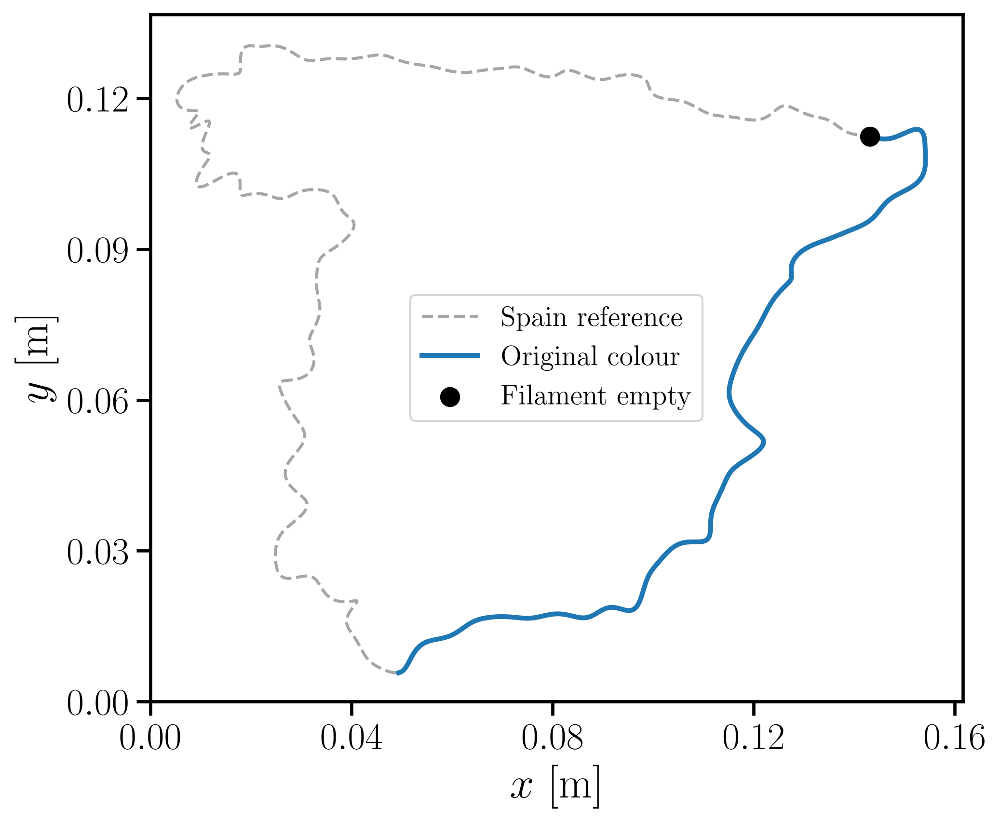
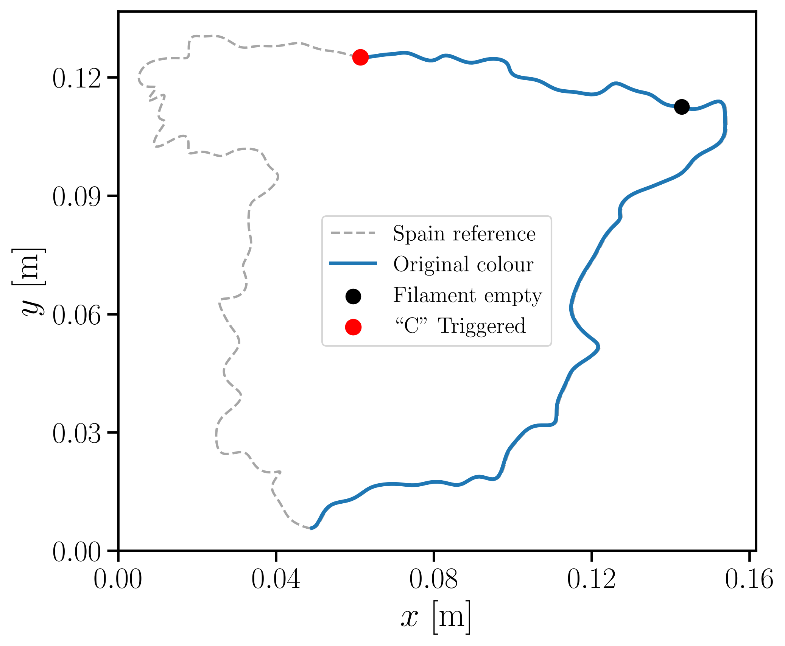
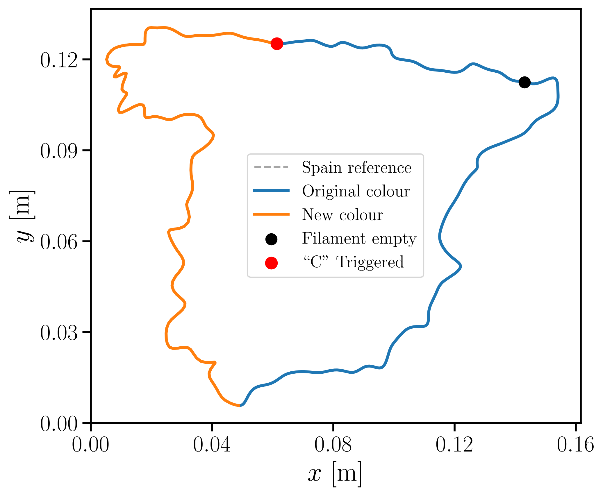
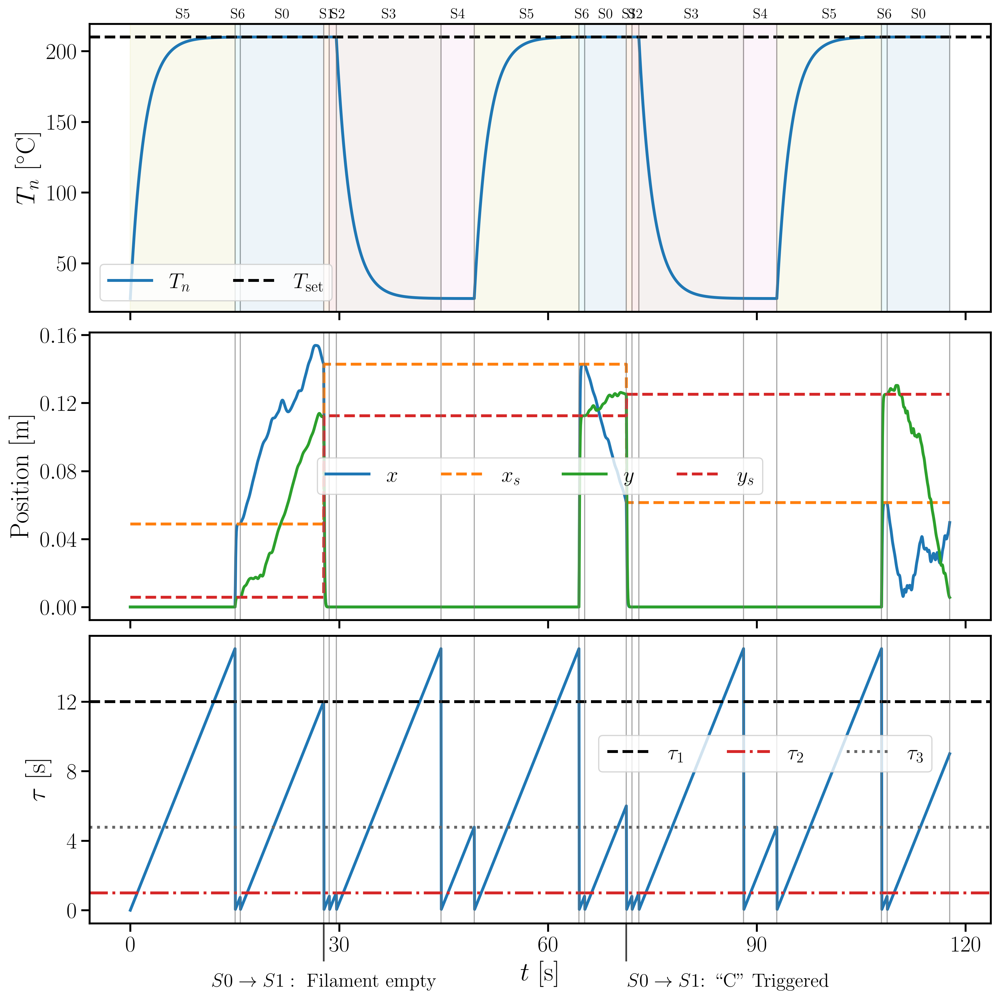

# Hybrid 3D Printer Model

A compact simulation of a 3D printer that combines continuous physical dynamics, discrete operating logic, and closed-loop control.

<p align="center">
  
  
  
</p>

<p align="center">
  
</p>

## Models

| Component | Purpose | Location |
|---|---|---|
| Nozzle thermal model | Electrical and thermal evolution of the nozzle | [`Q1.5/`](Q1.5/) |
| Motion model | CoreXY kinematics, motor dynamics, and inverse dynamics | [`corexy/`](corexy/), [`Q1.4/`](Q1.4/), [`Q3.2/`](Q3.2/) |
| Printed-material model | Thermal PDE for temperature evolution after deposition | [`Q1.6/`](Q1.6/) |
| Arbitrary-shape pipeline | Converts silhouettes into Fourier curves and printable trajectories | [`random-shape/`](random-shape/) |
| Finite-state machine | Models printing, returning home, wiping, cooling, replacement, and reheating | [`Q3.1/`](Q3.1/) |
| Positioning automaton | Detects correct arrival at home and the stored printing position | [`Q3.1/`](Q3.1/) |
| Hybrid model | Combines physical models, discrete transitions, events, and resets | [`Q3.1/`](Q3.1/) |
| Controller | Selects thermal and motion voltages and closes the loop in automated modes | [`Q3.1/`](Q3.1/) |

## Run

```bash
python3 -m venv .venv
.venv/bin/pip install -r requirements.txt
.venv/bin/python Q3.1/q3_1.py
```
