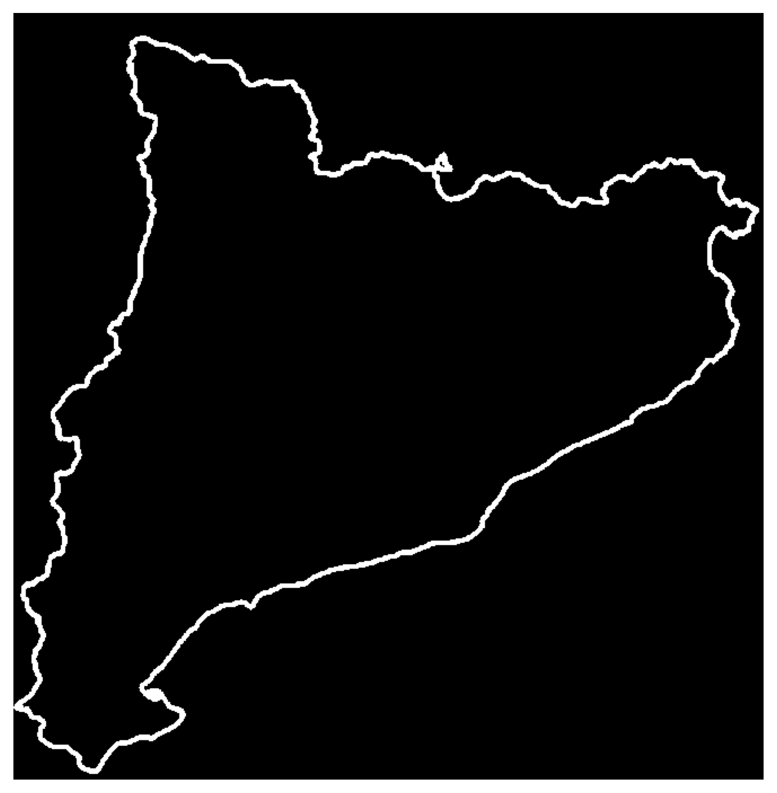
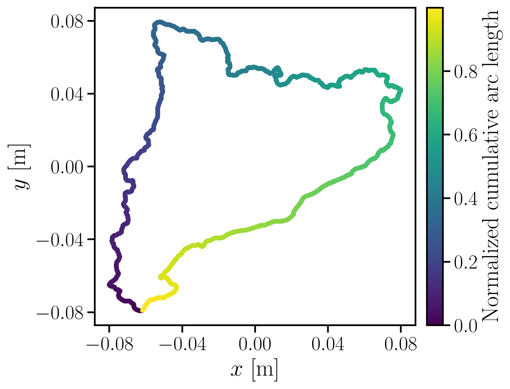
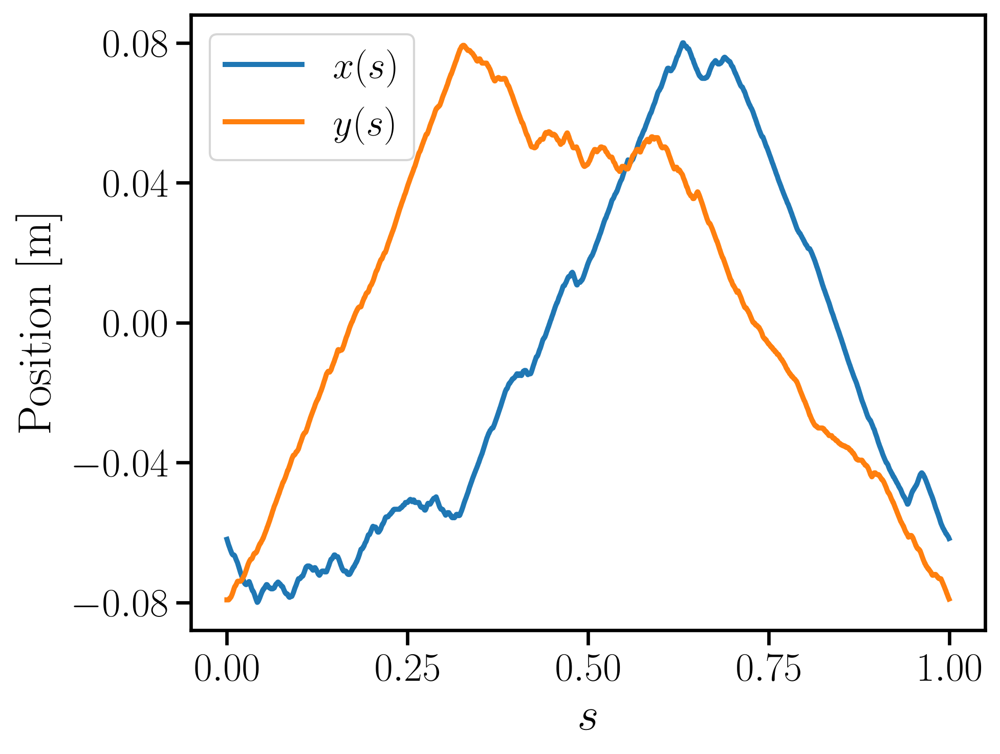
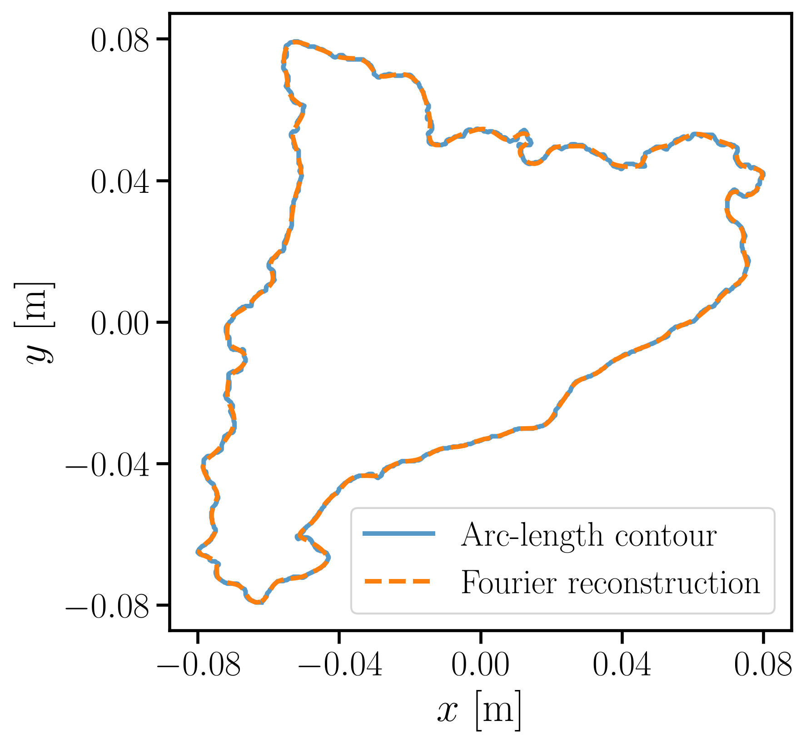
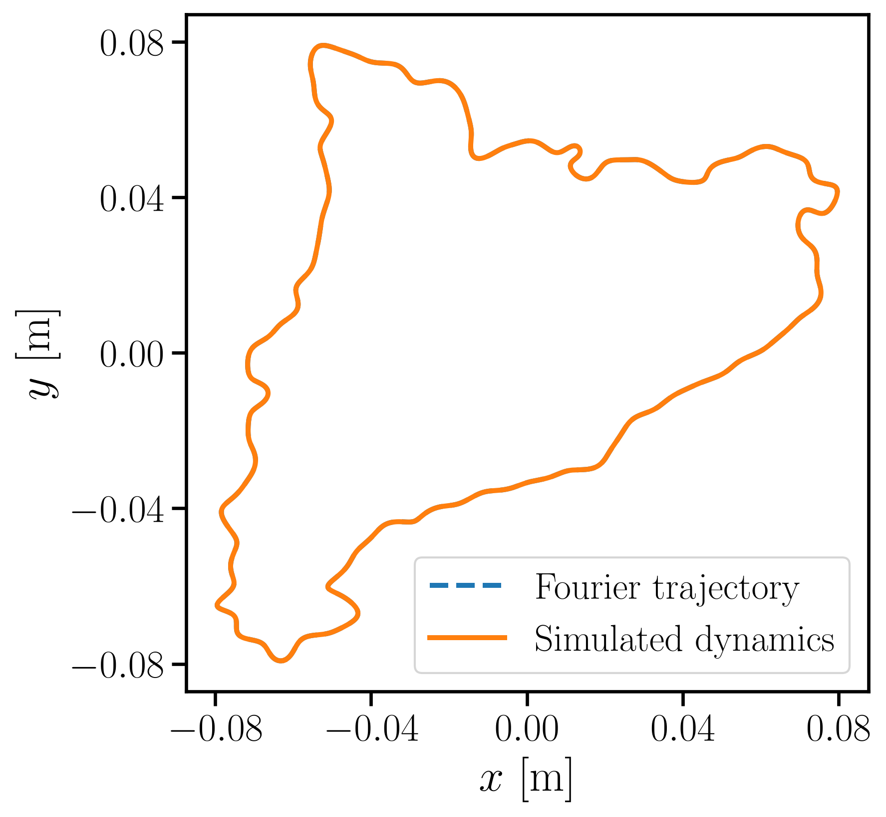
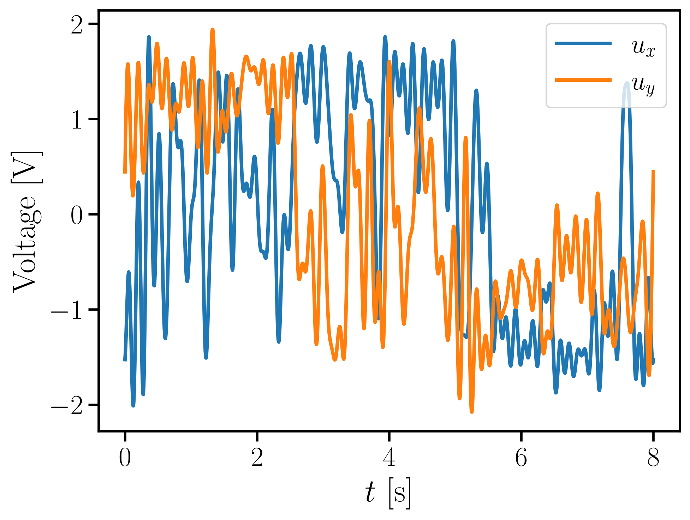

# Random silhouette pipeline

This pipeline converts a black-and-white silhouette into a periodic Cartesian
trajectory and verifies that the CoreXY model follows it. Black-on-white and
white-on-black images are both accepted.

## Processing stages

1. **Silhouette extraction.** Otsu thresholding separates both colours. The less
   prevalent colour is treated as foreground and its largest connected component
   is retained.

   

2. **Ordered contour and arc-length parametrization.** The outer boundary is
   traced in order, closed, and resampled at uniformly spaced values of normalized
   cumulative arc length, `s` in `[0, 1)`. This prevents drawing speed from
   depending on the original pixel sampling.

   

   

3. **Two-dimensional Fourier series.** The sampled curve is represented by the
   complex signal `z(s) = x(s) + j y(s)` and approximated by

   ```text
   z(s) = sum(c_k exp(j 2 pi k s)),  k = -N, ..., N.
   ```

   Analytic differentiation provides position, velocity, acceleration, and jerk.
   The default order is `N=50`.

   

4. **Inverse dynamics and simulation.** `inverse_dynamics.py` uses the physical parameters from
   the unchanged shared model in `../corexy/model.py` to compute the required decoupled voltages from the
   Fourier derivatives:

   ```text
   u = L_m C p''' + R_m C p'' + (2 K_m / r_m) p'
   C = (2 J_m + m r_m^2) / (K_tau r_m)
   ```

   These voltages are applied to the forward six-state model. Agreement between
   its `(x,y)` states and the Fourier reference verifies the calculation.

   

   

## Files and outputs

- `fourier_curve.py`: contour extraction, resampling, Fourier fitting, and evaluation.
- `inverse_dynamics.py`: voltage calculation and consistent trajectory-state initialization.
- `pipeline.py`: pipeline command, plotting, inverse-dynamics call, and simulation.
- `inputs/`: source silhouettes (contents are intentionally ignored by Git).
- `outputs/<image name>/`: figures, CSV data, Fourier coefficients, simulation data,
  and a numerical summary for each input (contents are intentionally ignored by Git).
- `../corexy/model.py`: unchanged shared parameters and forward dynamics.

## Running

From the repository root:

```bash
.venv/bin/pip install -r random-shape/requirements.txt
.venv/bin/python random-shape/pipeline.py
```

The default input is `inputs/Catalunya.png`. To process another image or change
the approximation:

```bash
.venv/bin/python random-shape/pipeline.py path/to/image.png --order 80 --period 10
```

Useful options include `--workspace-size` (largest dimension in metres),
`--contour-samples`, `--simulation-samples`, and `--output-root`.
